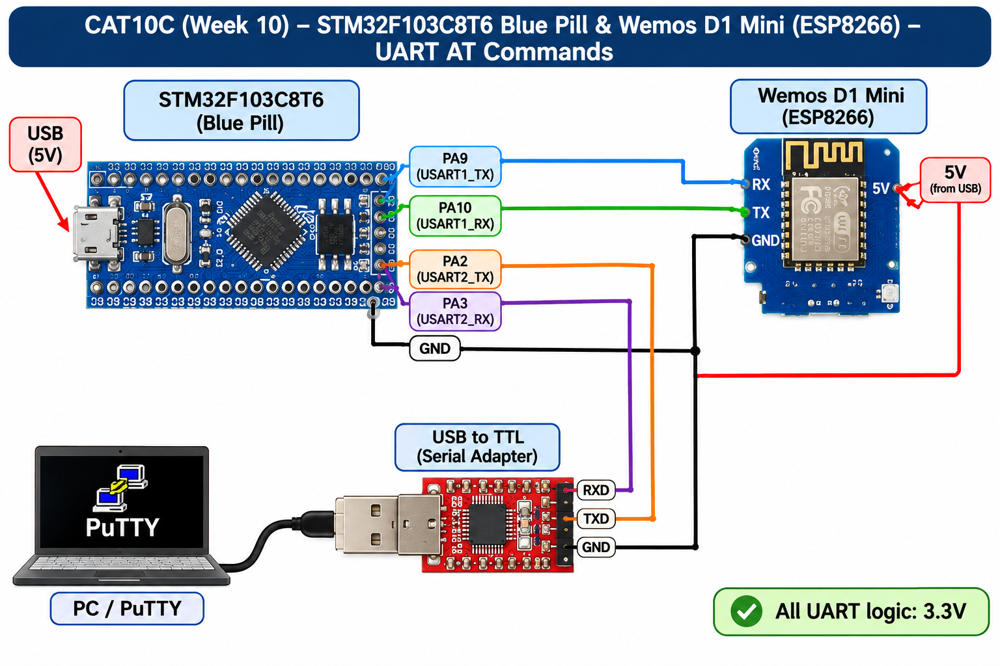

# EXPERIMENT DETAILS

**EXP:** CONTINUOUS ASSESMENT 10

**DATE: 05/10/2026**

**NAME OF EXP:** STM32 UART Communication with ESP8266 Wi-Fi Module

**HARDWARE SETUP / PLATFORM:** CubeMX + Keil MDK + STM32 Development Board Blue Pill STM32F103C8T6

---

## TASK 10A ESP8266 AT Command Communication

### 1. Circuit Diagram

The experiment uses the STM32 Blue Pill to communicate with the ESP8266 module through USART1. USART2 is used to display the ESP8266 response on the PC serial terminal.

- **Development Board:** STM32 Blue Pill
- **Microcontroller IC:** STM32F103C8T6
- **ESP8266 Communication:** USART1 (PA9 - TX, PA10 - RX)
- **Debug Communication:** USART2 (PA2 - TX, PA3 - RX)
- **Baud Rate:** 115200

### 2. Core Logic / Pseudocode / Code Base

**Working Principle:**

The experiment demonstrates serial communication between the STM32 and the ESP8266 Wi-Fi module using UART. The STM32 repeatedly transmits the AT command followed by a carriage return and newline through USART1. The response received from the ESP8266 is forwarded byte by byte through USART2 to the PC serial terminal. A delay of one second is introduced before repeating the process.

**Pseudocode:**

1. Initialize the HAL library and configure the GPIO and UART peripherals.
2. Configure USART1 and USART2 for 115200 baud communication.
3. Transmit the `AT` command followed by carriage return and newline through USART1.
4. Receive response bytes from the ESP8266 through USART1.
5. Forward each received byte to the PC serial terminal through USART2.
6. Introduce a delay of one second.
7. Repeat the process continuously.

**Code Base:**

UART transmission and reception are performed using `HAL_UART_Transmit()` and `HAL_UART_Receive()`. `HAL_Delay()` is used to introduce the one-second interval between AT command transmissions.

### 3. Inference

The STM32 communicates with the ESP8266 through USART1 and displays the module's response on the PC serial terminal through USART2, demonstrating UART-based AT command communication.
