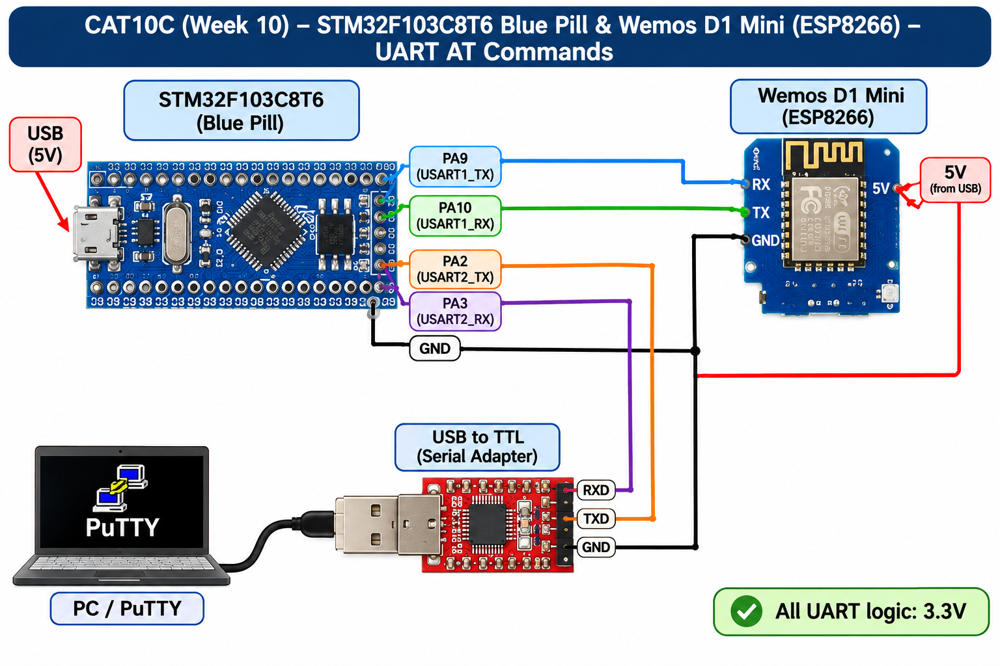

# EXPERIMENT DETAILS

**EXP:** CONTINUOUS ASSESMENT 10

**DATE: 05/10/2026**

**NAME OF EXP:** STM32 ESP8266 AT Command Testing

**HARDWARE SETUP / PLATFORM:** CubeMX + Keil MDK + STM32 Development Board Blue Pill STM32F103C8T6

---

## TASK 10B ESP8266 AT Command Investigation

### 1. Circuit Diagram

The experiment uses the STM32 Blue Pill to send a sequence of AT commands to the ESP8266 module through USART1. USART2 forwards the module responses to the PC serial terminal.

- **Development Board:** STM32 Blue Pill
- **Microcontroller IC:** STM32F103C8T6
- **ESP8266 Communication:** USART1 (PA9 - TX, PA10 - RX)
- **Debug Communication:** USART2 (PA2 - TX, PA3 - RX)
- **Baud Rate:** 115200

### 2. Core Logic / Pseudocode / Code Base

**Working Principle:**

The experiment investigates the ESP8266 AT command interface. The STM32 sends the commands `AT`, `AT+GMR`, `AT+CWMODE=1`, `AT+CWLAP`, and `AT+CIFSR` through USART1. The response to each command is received from the ESP8266 and forwarded to the PC serial terminal through USART2 for three seconds. A delay of 1.5 seconds is introduced between commands. After all commands are sent, the program continuously forwards any bytes received from the ESP8266 to the terminal.

**Pseudocode:**

1. Initialize the HAL library and configure the GPIO and UART peripherals.
2. Configure USART1 and USART2 for 115200 baud communication.
3. Display a startup message on the PC serial terminal.
4. Send the `AT` command to the ESP8266.
5. Receive and forward the response to the PC terminal for three seconds.
6. Repeat the process for `AT+GMR`, `AT+CWMODE=1`, `AT+CWLAP`, and `AT+CIFSR`.
7. Introduce a delay of 1.5 seconds between successive commands.
8. Display a completion message on the PC serial terminal.
9. Continuously receive bytes from USART1 and forward them through USART2.

**Code Base:**

The AT commands are transmitted using `HAL_UART_Transmit()`. Incoming response bytes are read using `HAL_UART_Receive()` and forwarded to the PC terminal through USART2. `HAL_Delay()` is used to control the response listening interval and the delay between commands.

### 3. Inference

The ESP8266 responds to a sequence of AT commands, allowing its firmware version, Wi-Fi operating mode, available access points, and IP information to be investigated through the PC serial terminal.
