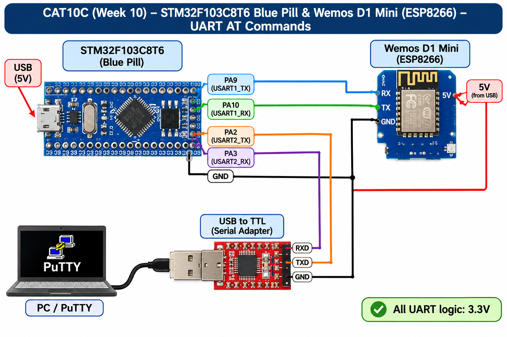

# EXPERIMENT DETAILS

**EXP:** CONTINUOUS ASSESMENT 10

**DATE: 05/10/2026**

**NAME OF EXP:** STM32 ESP8266 Wi-Fi Connection

**HARDWARE SETUP / PLATFORM:** CubeMX + Keil MDK + STM32 Development Board Blue Pill STM32F103C8T6

---

## TASK 10C ESP8266 Wi-Fi Station Mode and Connection

### 1. Circuit Diagram

The experiment uses the STM32 Blue Pill to configure the ESP8266 module and connect it to a Wi-Fi network through AT commands. USART2 is used to display the module responses on the PC serial terminal.

- **Development Board:** STM32 Blue Pill
- **Microcontroller IC:** STM32F103C8T6
- **ESP8266 Communication:** USART1 (PA9 - TX, PA10 - RX)
- **Debug Communication:** USART2 (PA2 - TX, PA3 - RX)
- **Baud Rate:** 115200
- **Wi-Fi Credentials:** SSID and password placeholders in the code

### 2. Core Logic / Pseudocode / Code Base

**Working Principle:**

The experiment demonstrates Wi-Fi configuration and connection using the ESP8266 AT command interface. The STM32 first sends `AT+CWMODE=1` to configure the ESP8266 in station mode and forwards the response to the PC serial terminal for two seconds. It then sends the Wi-Fi join command using the SSID and password placeholders in the code and forwards the response for up to eight seconds. Next, it sends `AT+CIFSR` to request the IP address and forwards the response for three seconds. After these steps, incoming bytes from the ESP8266 are continuously forwarded to the PC terminal.

**Pseudocode:**

1. Initialize the HAL library and configure the GPIO and UART peripherals.
2. Configure USART1 and USART2 for 115200 baud communication.
3. Send `AT+CWMODE=1` through USART1.
4. Receive and forward the ESP8266 response to the PC terminal for two seconds.
5. Send `AT+CWJAP="Your_SSID","Your_Password"` through USART1.
6. Receive and forward the response for up to eight seconds.
7. Send `AT+CIFSR` to request the IP address.
8. Receive and forward the response for three seconds.
9. Continuously receive bytes from USART1 and forward them through USART2.

**Code Base:**

The AT commands are transmitted using `HAL_UART_Transmit()`. Responses from the ESP8266 are received using `HAL_UART_Receive()` and forwarded to the PC terminal through USART2. `HAL_Delay()` is used for the command response intervals. The SSID and password placeholders must be replaced with the required Wi-Fi credentials before attempting a connection.

### 3. Inference

The ESP8266 is configured in station mode and attempts to connect to the specified Wi-Fi network. The module's responses and IP information are displayed on the PC serial terminal, demonstrating Wi-Fi connection control through UART AT commands.
