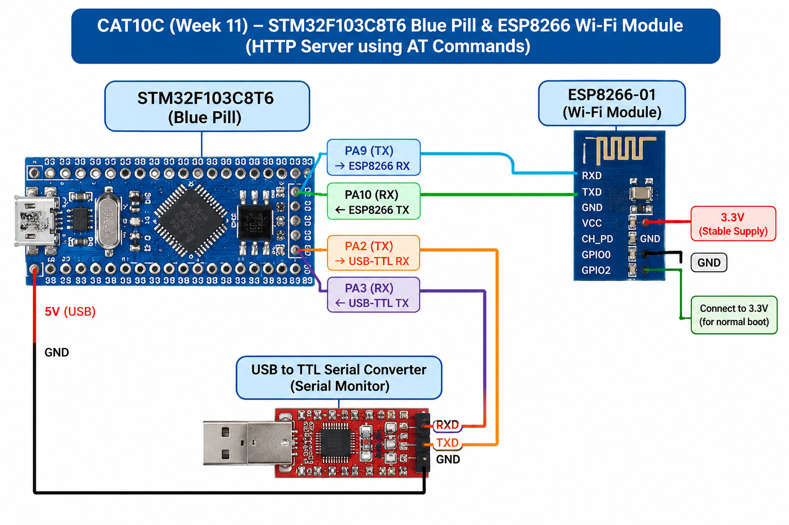

# EXPERIMENT DETAILS

**EXP:** CONTINUOUS ASSESMENT 11

**DATE: 12/10/2026**

**NAME OF EXP:** STM32 and ESP8266 UART Communication

**HARDWARE SETUP / PLATFORM:** CubeMX + Keil MDK + STM32 Development Board Blue Pill STM32F103C8T6

---

## TASK 11A ESP8266 AT Command Communication

### 1. Circuit Diagram

The experiment uses the STM32 Blue Pill to communicate with the ESP8266 module through USART1. USART2 is used to display the received ESP8266 data on the PC serial terminal.

- **Development Board:** STM32 Blue Pill
- **Microcontroller IC:** STM32F103C8T6
- **ESP8266 Communication:** USART1
- **Debug Communication:** USART2
- **Baud Rate:** 115200

### 2. Core Logic / Pseudocode / Code Base

**Working Principle:**

The experiment demonstrates UART communication between the STM32 and the ESP8266 module. After initializing the system clock, GPIO, USART1, and USART2, the STM32 transmits the `AT` command followed by carriage return and newline through USART1. The program then continuously receives one byte at a time from the ESP8266 through USART1 and forwards each received byte to the PC serial terminal through USART2.

**Pseudocode:**

1. Initialize the HAL library.
2. Configure the system clock and GPIO.
3. Initialize USART1 and USART2 at 115200 baud.
4. Transmit the `AT` command through USART1.
5. Continuously receive one byte from USART1.
6. Forward the received byte through USART2 to the PC serial terminal.
7. Repeat the receive-and-forward process continuously.

**Code Base:**

The `AT` command is transmitted using `HAL_UART_Transmit()`. Data is received from the ESP8266 using `HAL_UART_Receive()` and forwarded to the PC terminal through USART2 using `HAL_UART_Transmit()`. Both UART peripherals are configured for 115200 baud, 8 data bits, no parity, and 1 stop bit.

### 3. Inference

The STM32 sends an AT command to the ESP8266 and continuously forwards the module's received data to the PC serial terminal, demonstrating UART-based serial communication.
