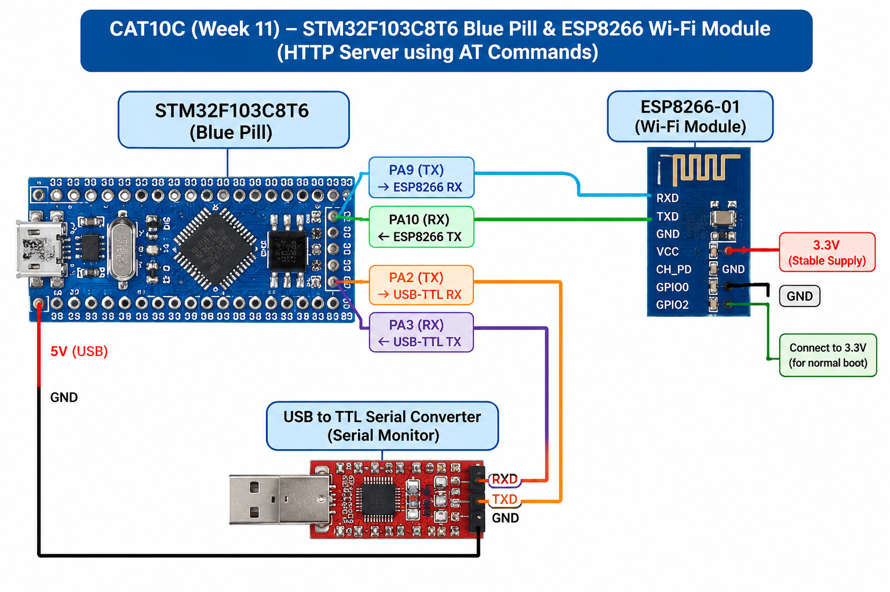

# EXPERIMENT DETAILS

**EXP:** CONTINUOUS ASSESMENT 11

**DATE: 12/10/2026**

**NAME OF EXP:** STM32-Based ESP8266 HTTP Server

**HARDWARE SETUP / PLATFORM:** CubeMX + Keil MDK + STM32 Development Board Blue Pill STM32F103C8T6

---

## TASK 11C ESP8266 HTTP Server and HTML Response

### 1. Circuit Diagram

The experiment uses the STM32 Blue Pill to configure the ESP8266 as a TCP server on port 80. USART2 is used to display incoming ESP8266 data and server messages on the PC serial terminal.

- **Development Board:** STM32 Blue Pill
- **Microcontroller IC:** STM32F103C8T6
- **ESP8266 Communication:** USART1
- **Debug Communication:** USART2
- **Baud Rate:** 115200
- **TCP Server Port:** 80

### 2. Core Logic / Pseudocode / Code Base

**Working Principle:**

The experiment configures the ESP8266 for multiple connections and starts a TCP server on port 80 using the AT commands `AT+CIPMUX=1` and `AT+CIPSERVER=1,80`. The STM32 continuously receives ESP8266 data and forwards it to the PC serial terminal. When a received request contains the `+IPD` indicator, the program extracts the connection ID and prepares an HTML page containing the heading "STM32 IoT Node" and the message "Hello from STM32". It constructs an HTTP 200 OK response with the content type and content length, sends the response using `AT+CIPSEND`, and closes the client connection using `AT+CIPCLOSE`.

**Pseudocode:**

1. Initialize the HAL library, system clock, GPIO, USART1, and USART2.
2. Display the HTTP server initialization message on the PC terminal.
3. Send `AT+CIPMUX=1` to enable multiple connections.
4. Send `AT+CIPSERVER=1,80` to start the TCP server on port 80.
5. Display a message indicating that the HTTP server is active.
6. Continuously receive data from the ESP8266 through USART1.
7. Forward each received byte to the PC terminal through USART2.
8. Store incoming data in a buffer and check for the `+IPD` indicator.
9. Extract the connection ID from the received request.
10. Prepare the HTML page and construct an HTTP 200 OK response with its content length.
11. Send the `AT+CIPSEND` command with the connection ID and total response length.
12. Transmit the HTTP response through USART1.
13. Close the connection using `AT+CIPCLOSE`.
14. Clear the receive buffer and wait for the next client request.

**Code Base:**

The ESP8266 AT commands and HTTP response are transmitted using `HAL_UART_Transmit()`. Incoming data is received using `HAL_UART_Receive()`. The `strstr()` function detects the `+IPD` request indicator, while `sprintf()` constructs the HTTP response and the `AT+CIPSEND` and `AT+CIPCLOSE` commands. `strlen()` is used for string lengths, and `memset()` clears the receive buffer after processing each request.

### 3. Inference

The STM32 configures the ESP8266 as a TCP server on port 80 and serves an HTML response containing the STM32 IoT Node message to a connecting client. This demonstrates a basic HTTP server using STM32 UART communication and ESP8266 AT commands.
