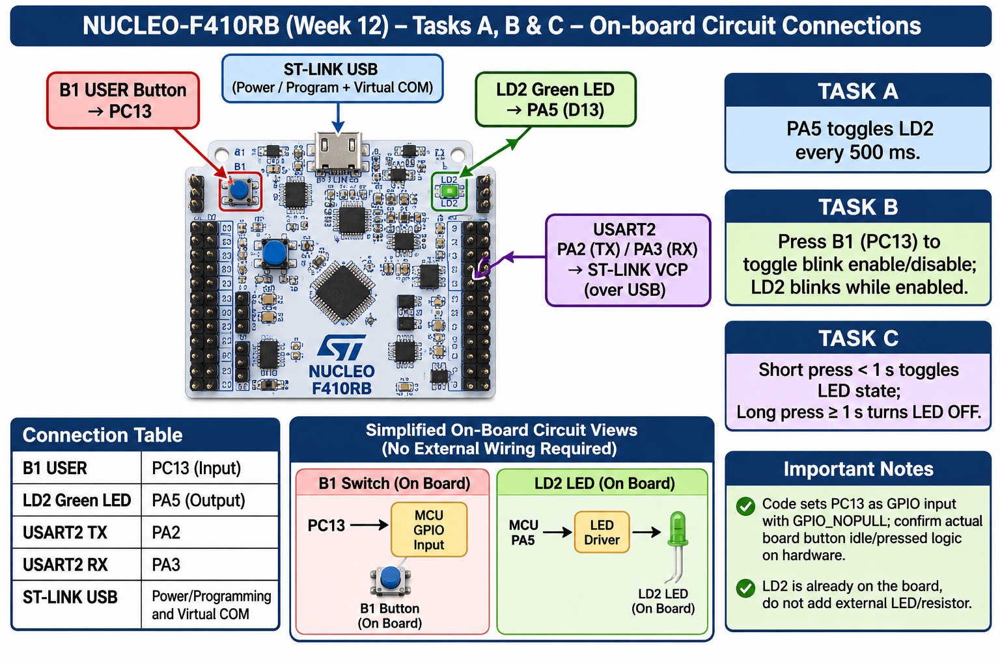

# EXPERIMENT DETAILS

**EXP:** CONTINUOUS ASSESMENT 12

**DATE: 14/10/2026**

**NAME OF EXP:** STM32 GPIO LED Blinking

**HARDWARE SETUP / PLATFORM:** CubeMX + Keil MDK + STM32 NUCLEO-F410RB Development Board

---

## TASK 12A LED Blinking

### 1. Circuit Diagram

The experiment uses the onboard LED of the STM32 NUCLEO-F410RB development board.

- **Development Board:** STM32 NUCLEO-F410RB
- **Microcontroller:** STM32F410RB
- **Output Pin:** PA5
- **Peripheral:** Onboard LED (LD2)
- **Blinking Interval:** 500 ms

### 2. Core Logic / Pseudocode / Code Base

**Working Principle:**

The experiment demonstrates GPIO output control using the STM32 HAL library. The GPIO pin PA5, connected to the onboard LED LD2, is configured as an output. The program continuously toggles the LED state with a delay of 500 ms between transitions. USART2 is also initialized as part of the program configuration.

**Pseudocode:**

1. Initialize the HAL library.
2. Configure the system clock and GPIO peripherals.
3. Initialize USART2.
4. Configure PA5 as a GPIO output.
5. Toggle the onboard LED connected to PA5.
6. Introduce a delay of 500 ms.
7. Repeat the process continuously.

**Code Base:**

The onboard LED is controlled using `HAL_GPIO_TogglePin()` on GPIO pin PA5. `HAL_Delay()` provides the 500 ms blinking interval. USART2 is configured for 115200 baud, 8 data bits, no parity, and 1 stop bit.

### 3. Inference

The onboard LED LD2 blinks continuously at 500 ms intervals, demonstrating GPIO output configuration and control using STM32 HAL functions.
