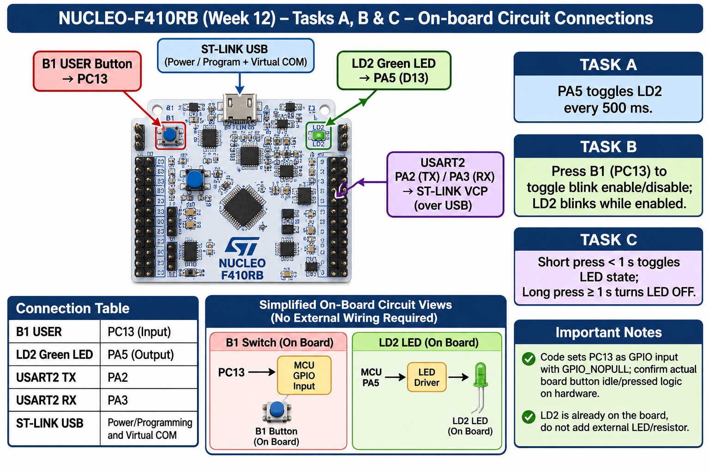

# EXPERIMENT DETAILS

**EXP:** CONTINUOUS ASSESMENT 12

**DATE: 14/10/2026**

**NAME OF EXP:** STM32 Push-Button Controlled LED Blinking

**HARDWARE SETUP / PLATFORM:** CubeMX + Keil MDK + STM32 NUCLEO-F410RB Development Board

---

## TASK 12B Push-Button Controlled LED Blinking

### 1. Circuit Diagram

The experiment uses the onboard push-button as a GPIO input to control the onboard LED of the STM32 NUCLEO-F410RB development board.

- **Development Board:** STM32 NUCLEO-F410RB
- **Microcontroller:** STM32F410RB
- **Input Pin:** PC13
- **Output Pin:** PA5
- **Peripheral:** Onboard push-button and LED LD2
- **Blinking Interval:** 100 ms

### 2. Core Logic / Pseudocode / Code Base

**Working Principle:**

The experiment demonstrates push-button controlled LED blinking. The push-button connected to PC13 is monitored continuously. A valid button press is debounced using a 20 ms delay and toggles the blinking state. When blinking is enabled, the onboard LED connected to PA5 toggles at 100 ms intervals. USART2 is also initialized as part of the program configuration.

**Pseudocode:**

1. Initialize the HAL library.
2. Configure the system clock and GPIO peripherals.
3. Initialize USART2.
4. Configure PC13 as a push-button input and PA5 as an LED output.
5. Continuously monitor the push-button state.
6. When a button press is detected, wait for 20 ms to debounce the input.
7. Confirm the button press and toggle the blinking enable state.
8. Wait for the button to be released before detecting another press.
9. If blinking is enabled, toggle the LED on PA5 at 100 ms intervals.
10. Repeat the process continuously.

**Code Base:**

The push-button state is read using `HAL_GPIO_ReadPin()`. `HAL_Delay()` provides the 20 ms debounce interval and the 100 ms blinking interval. `HAL_GPIO_TogglePin()` changes the LED state on PA5. USART2 is configured for 115200 baud, 8 data bits, no parity, and 1 stop bit.

### 3. Inference

The onboard push-button enables or disables LED blinking. The LED LD2 toggles at 100 ms intervals when blinking is enabled, demonstrating GPIO input handling, switch debouncing, and output control using STM32 HAL functions.
