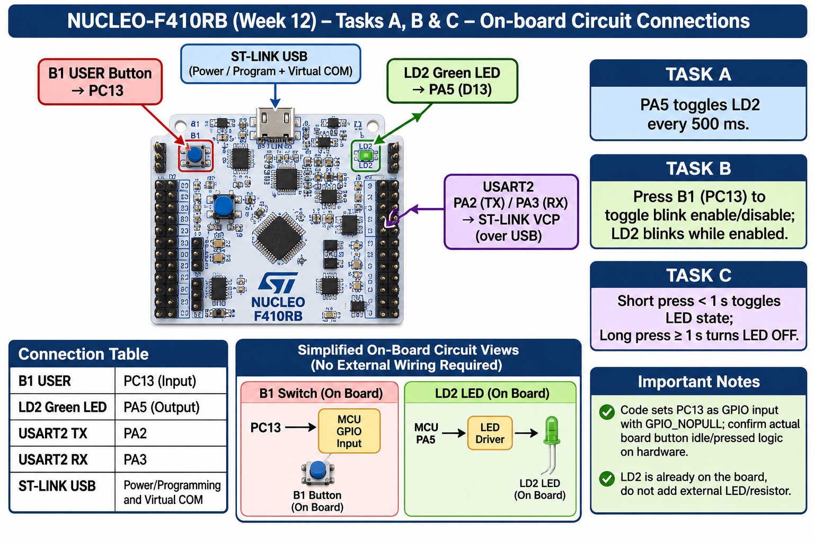

# EXPERIMENT DETAILS

**EXP:** CONTINUOUS ASSESMENT 12

**DATE: 14/10/2026**

**NAME OF EXP:** STM32 Short and Long Push-Button Press Control

**HARDWARE SETUP / PLATFORM:** CubeMX + Keil MDK + STM32 NUCLEO-F410RB Development Board

---

## TASK 12C Short and Long Press Detection

### 1. Circuit Diagram

The experiment uses the onboard push-button as a GPIO input to control the onboard LED of the STM32 NUCLEO-F410RB development board based on the duration of the button press.

- **Development Board:** STM32 NUCLEO-F410RB
- **Microcontroller:** STM32F410RB
- **Input Pin:** PC13
- **Output Pin:** PA5
- **Peripheral:** Onboard push-button and LED LD2
- **Press Duration Threshold:** 1 second

### 2. Core Logic / Pseudocode / Code Base

**Working Principle:**

The experiment detects whether the onboard push-button is pressed for a short or long duration. The button connected to PC13 is monitored, and the press duration is measured. A short press of less than one second toggles the LED connected to PA5. A long press of one second or more turns the LED OFF. USART2 is also initialized as part of the program configuration.

**Pseudocode:**

1. Initialize the HAL library.
2. Configure the system clock and GPIO peripherals.
3. Initialize USART2.
4. Configure PC13 as a push-button input and PA5 as an LED output.
5. Continuously monitor the push-button state.
6. When a button press is detected, record the press start time.
7. Wait until the button is released and determine the press duration.
8. If the press duration is less than one second, toggle the LED on PA5.
9. If the press duration is one second or longer, turn the LED OFF.
10. Repeat the process continuously.

**Code Base:**

The push-button state is read using `HAL_GPIO_ReadPin()`. `HAL_GetTick()` is used to measure the button press duration. `HAL_GPIO_TogglePin()` toggles the LED for a short press, while `HAL_GPIO_WritePin()` turns the LED OFF for a long press. USART2 is configured for 115200 baud, 8 data bits, no parity, and 1 stop bit.

### 3. Inference

The STM32 distinguishes short and long push-button presses to control the onboard LED. A short press toggles the LED, while a long press turns it OFF, demonstrating time-based input handling using STM32 HAL functions.
