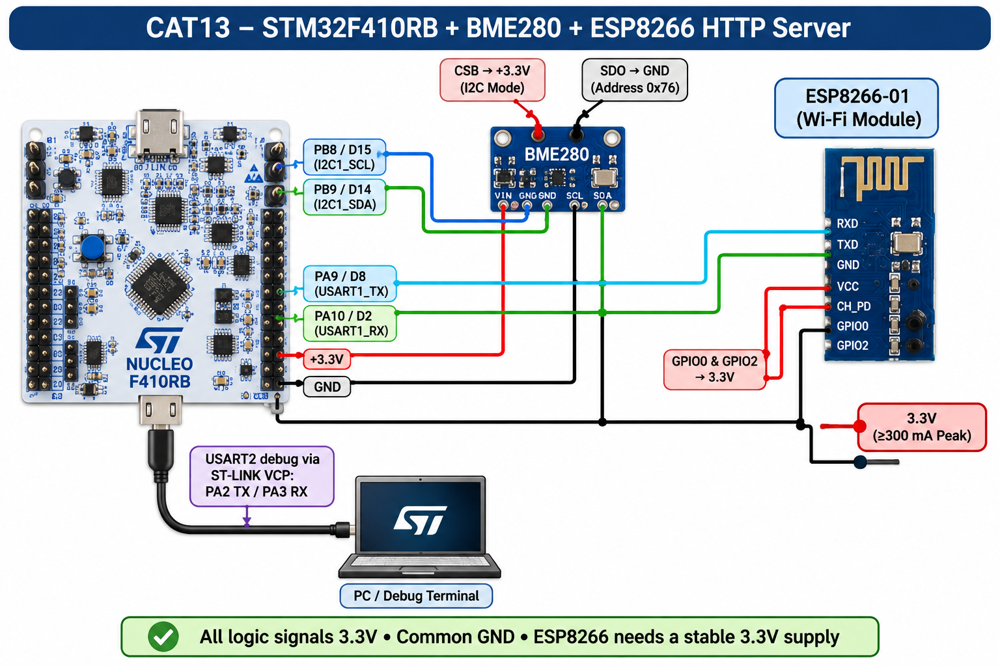

# EXPERIMENT DETAILS

**EXP:** CONTINUOUS ASSESMENT 13

**DATE: 23/10/2026**

**NAME OF EXP:** BME280 Sensor Data Monitoring Using ESP8266 HTTP Server

**HARDWARE SETUP / PLATFORM:** CubeMX + Keil MDK + STM32 Development Board NUCLEO-F410RB (STM32F410RB)

---

## TASK 13 BME280 Sensor Data through ESP8266 HTTP Server

### 1. Circuit Diagram

The experiment uses the STM32F410RB to read temperature, humidity, and pressure from the BME280 sensor through I2C. The ESP8266 is configured as a TCP server on port 80 and sends the sensor readings to an HTTP client in JSON format. USART2 is used for displaying debug messages on the PC serial terminal.

- **Development Board:** STM32 NUCLEO-F410RB
- **Microcontroller IC:** STM32F410RB
- **BME280 Communication:** I2C1 (PB8 - SCL, PB9 - SDA)
- **BME280 I2C Address:** 0x76
- **ESP8266 Communication:** USART1 (PA9 - TX, PA10 - RX)
- **Debug Communication:** USART2 (PA2 - TX, PA3 - RX)
- **UART Baud Rate:** 115200
- **ESP8266 TCP Server Port:** 80
- **Sensor Supply:** 3.3V

### 2. Core Logic / Pseudocode / Code Base

**Working Principle:**

The STM32 initializes the BME280 sensor through I2C1 using the Bosch BME280 driver. The sensor is configured in normal mode with 1x oversampling for temperature, pressure, and humidity, a filter coefficient of 2, and a 1000 ms standby time. The ESP8266 is configured for multiple connections using `AT+CIPMUX=1` and started as a TCP server on port 80 using `AT+CIPSERVER=1,80`.

During the main loop, the STM32 reads the latest temperature, humidity, and pressure values from the BME280 and displays them on the PC terminal through USART2. It checks incoming ESP8266 data for the `+IPD` request indicator. When a client request is detected, the program extracts the connection ID and constructs a JSON payload containing the sensor readings. It then creates an HTTP 200 OK response with an application/json content type, sends the response using `AT+CIPSEND`, and closes the client connection using `AT+CIPCLOSE`.

**Pseudocode:**

1. Initialize the HAL library and configure the system clock.
2. Initialize GPIO, I2C1, USART1, and USART2.
3. Configure the BME280 device structure with I2C read, write, and delay callbacks.
4. Initialize the BME280 sensor using I2C address 0x76.
5. Configure temperature, pressure, and humidity oversampling to 1x, filter coefficient to 2, and standby time to 1000 ms.
6. Set the BME280 to normal operating mode.
7. Send `AT+CIPMUX=1` to enable multiple connections on the ESP8266.
8. Send `AT+CIPSERVER=1,80` to start the TCP server on port 80.
9. Continuously read temperature, humidity, and pressure from the BME280.
10. Display the sensor readings through USART2.
11. Receive data from the ESP8266 through USART1 and forward the received byte to USART2.
12. Store received bytes in a buffer and check for the `+IPD` request indicator.
13. Extract the client connection ID from the received request.
14. Construct a JSON payload containing temperature, humidity, and pressure.
15. Build an HTTP 200 OK response with the JSON content and its content length.
16. Send the `AT+CIPSEND` command with the connection ID and response length.
17. Transmit the HTTP JSON response through USART1.
18. Close the client connection using `AT+CIPCLOSE`.
19. Clear the receive buffer and continue monitoring sensor data and client requests.

**Code Base:**

The BME280 sensor is initialized and configured using `bme280_init()`, `bme280_set_sensor_settings()`, and `bme280_set_sensor_mode()`. The functions `user_i2c_read()` and `user_i2c_write()` connect the Bosch driver to STM32 HAL I2C memory read and write operations. Sensor measurements are obtained using `bme280_get_sensor_data()`.

The ESP8266 communicates with the STM32 through USART1 using `HAL_UART_Transmit()` and `HAL_UART_Receive()`. USART2 displays sensor readings and debug information on the PC terminal through the `UART_Print()` function. The `strstr()` function detects incoming `+IPD` request data, while `snprintf()` constructs the JSON payload, HTTP response, and AT commands. `strlen()` calculates transmission lengths, and `memset()` clears the receive buffer after a request is processed.

### 3. Inference

The STM32F410RB successfully interfaces with the BME280 sensor through I2C and uses the ESP8266 as a TCP server to provide sensor readings to an HTTP client in JSON format. Temperature, humidity, and pressure values are also displayed on the PC serial terminal through USART2. This experiment demonstrates sensor interfacing and the transmission of environmental data over a Wi-Fi-based HTTP connection.
