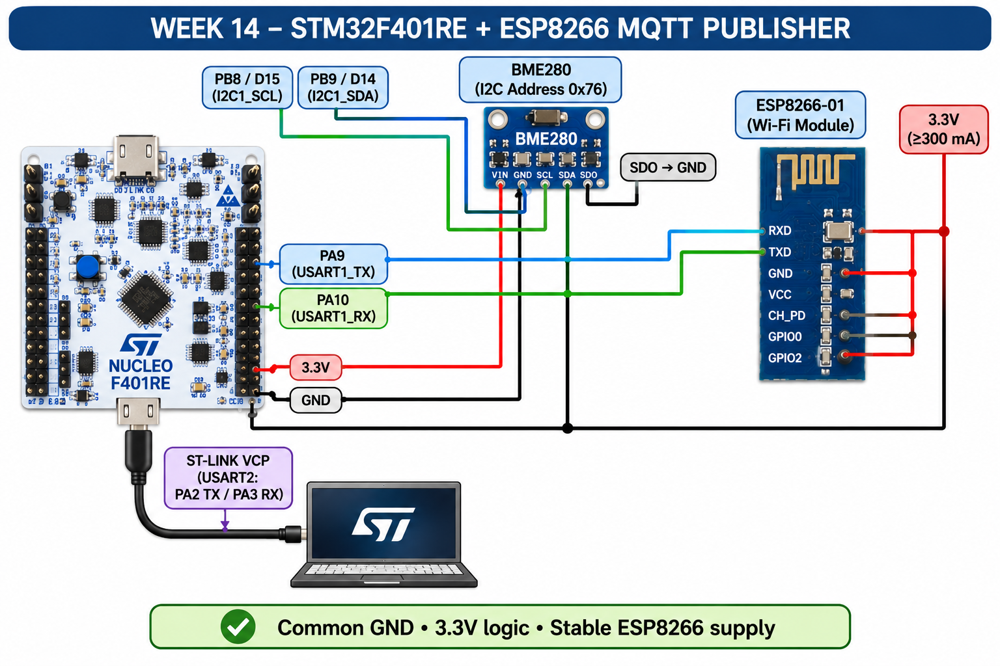

# EXPERIMENT DETAILS

**EXP:** CONTINUOUS ASSESMENT 14

**DATE: 27/10/2026**

**NAME OF EXP:** STM32-Based MQTT Data Publishing Using ESP8266

**HARDWARE SETUP / PLATFORM:** CubeMX + Keil MDK + STM32 Development Board NUCLEO-F401RE (STM32F401RE)

---

## TASK 14 MQTT Data Publishing Using ESP8266

### 1. Circuit Diagram

The experiment uses the STM32F401RE to communicate with an ESP8266 Wi-Fi module and publish data to an MQTT broker. The ESP8266 connects to the Wi-Fi network and establishes a TCP connection with the public MQTT broker. The STM32 then publishes sensor-related data to the configured MQTT topic.

- **Development Board:** STM32 NUCLEO-F401RE
- **Microcontroller IC:** STM32F401RE
- **Wi-Fi Module:** ESP8266
- **Wi-Fi SSID:** SNUC
- **MQTT Broker:** broker.emqx.io
- **MQTT Port:** 1883
- **MQTT Topic:** `stm32/bme280/data`
- **Communication Protocol:** MQTT over TCP
- **Data Type:** Dummy sensor values (actual BME280 sensor readings are not implemented)

### 2. Core Logic / Pseudocode / Code Base

**Working Principle:**

The STM32F401RE uses the ESP8266 Wi-Fi module to establish network connectivity and communicate with an MQTT broker. The ESP8266 is configured to connect to the Wi-Fi network with the SSID `SNUC`. After connecting to the network, it establishes a TCP connection with the MQTT broker `broker.emqx.io` on port `1883`.

The STM32 acts as an MQTT publisher and sends data to the topic `stm32/bme280/data`. The published payload contains dummy sensor values representing BME280-related measurements. The program demonstrates MQTT-based data transmission, but actual readings from a BME280 sensor are not implemented in this task.

**Pseudocode:**

1. Initialize the HAL library and configure the system clock and required peripherals.
2. Initialize the ESP8266 Wi-Fi module.
3. Configure the ESP8266 in station mode.
4. Connect the ESP8266 to the Wi-Fi network using the SSID `SNUC` and the configured password.
5. Establish a TCP connection with the MQTT broker `broker.emqx.io` on port `1883`.
6. Configure the MQTT client connection parameters.
7. Establish the MQTT connection with the broker.
8. Prepare the sensor-data payload using the dummy values defined in the program.
9. Publish the payload to the MQTT topic `stm32/bme280/data`.
10. Repeat the publishing operation according to the delay configured in the program.

**Code Base:**

The ESP8266 Wi-Fi module is used for network connectivity and communication with the MQTT broker. The program configures the broker connection using the host name `broker.emqx.io` and port `1883`. MQTT client settings are initialized before establishing the broker connection. The MQTT publishing function sends the prepared payload to the topic `stm32/bme280/data`.

The values published in this task are dummy sensor values. The task demonstrates MQTT publishing through the ESP8266 and does not implement direct BME280 sensor measurement.

### 3. Inference

The STM32F401RE uses the ESP8266 to connect to a Wi-Fi network and publish data to the MQTT broker `broker.emqx.io` on port `1883`. The data is published to the topic `stm32/bme280/data` using dummy sensor values. This experiment demonstrates the basic implementation of MQTT-based IoT data publishing from an STM32 development board.
