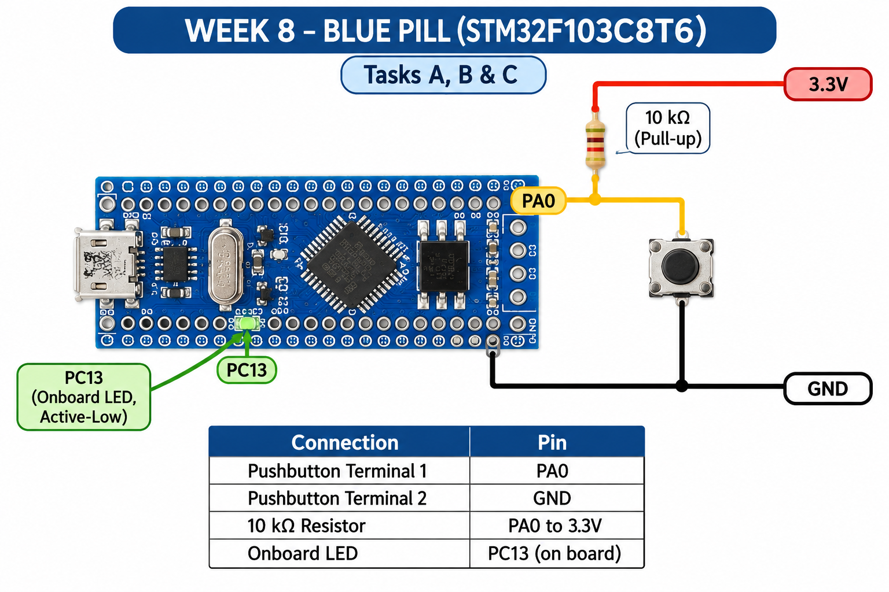

# EXPERIMENT DETAILS

**EXP:** CONTINUOUS ASSESSMENT 8

**DATE:** 21/09/2026

**NAME OF EXP:** STM32 GPIO Bring-Up and Switch-Controlled LED

**HARDWARE SETUP / PLATFORM:** CubeMX + Keil MDK + STM32 Development Board Blue Pill STM32F103C8T6

---

## TASK 8A GPIO Input/Output

### 1. Circuit Diagram

The experiment uses a push-button as a GPIO input and the onboard LED of the STM32 Blue Pill as a GPIO output.

- **Development Board:** STM32 Blue Pill
- **Microcontroller IC:** STM32F103C8T6
- **Input Pin:** PA0
- **Output Pin:** PC13
- **Peripheral:** Push-button and onboard LED

### 2. Core Logic / Pseudocode / Code Base

**Working Principle:**

The experiment demonstrates GPIO input and output control using the STM32 HAL library. The program continuously reads the state of the push-button connected to PA0. When the input is LOW, the onboard LED connected to PC13 is turned ON. When the input is HIGH, the LED is turned OFF. The onboard LED is active-low.

**Pseudocode:**

1. Initialize the HAL library.
2. Configure the system clock and GPIO.
3. Continuously read the state of PA0.
4. If PA0 is LOW, set PC13 LOW to turn the LED ON.
5. Otherwise, set PC13 HIGH to turn the LED OFF.
6. Repeat the process continuously.

**Code Base:**

The input state is read using `HAL_GPIO_ReadPin()`. The onboard LED is controlled using `HAL_GPIO_WritePin()` on GPIO pin PC13.

### 3. Inference

The onboard LED responds to the push-button state, demonstrating GPIO input reading and output control using STM32 HAL functions.

