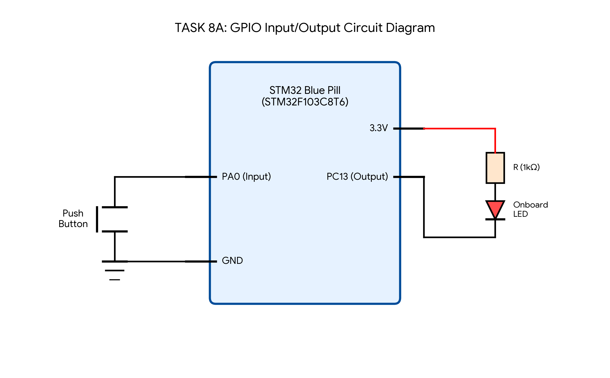

# EXPERIMENT 8

**EXP:** 8

**DATE:** 18/09/2026

**NAME OF EXP:** STM32 GPIO Bring-Up and Switch-Controlled LED

**HARDWARE SETUP / PLATFORM:** STM32 Blue Pill (STM32F103C8T6) + CubeMX + Keil MDK

**TASK NO:** TASK 8A

---

## 1. Circuit Diagram


### Hardware Connections

| Component | Connection |
|---|---|
| STM32F103C8T6 PA0 | Connected to Push-Button Switch (Digital Input) |
| Push-Button Terminal 2 | Connected to GND |
| STM32F103C8T6 PC13 | Connected to Onboard LED Cathode |
| Onboard LED Anode | Connected to 3.3V through a 1 kOhm current-limiting resistor |
| OSC_IN / OSC_OUT | Connected to 8 MHz HSE Crystal Oscillator |
| NRST | Connected to Reset Circuit |
| VDD / 3.3V | +3.3V Power Supply |
| VSS / GND | Ground |

**System Clock Frequency:** 72 MHz (HSE + PLL)

**LED Configuration:** Active-LOW

The onboard LED turns ON when PC13 is LOW (`GPIO_PIN_RESET`) and turns OFF when PC13 is HIGH (`GPIO_PIN_SET`).

### Circuit Diagram



---

## 2. Core Logic / Pseudocode / Code Base

### Working Principle

The STM32F103C8T6 microcontroller reads the logic level of a push-button connected to pin PA0 and controls the onboard LED connected to pin PC13 using the STM32 HAL library.

When the push-button is pressed, PA0 reads a LOW state (`GPIO_PIN_RESET`), and the firmware drives PC13 LOW to turn the LED ON. When the button is released, PC13 is set HIGH to turn the LED OFF, ensuring the LED directly follows the switch state.

### Pseudocode

1. Start the program and initialize the STM32 HAL library.
2. Configure the system clock and initialize GPIO pins PA0 (Input) and PC13 (Output).
3. Enter the infinite `while(1)` loop.
4. Read the input state of pin PA0 using `HAL_GPIO_ReadPin()`.
5. If PA0 is LOW (button pressed), write LOW to PC13 to turn the LED ON.
6. Otherwise, write HIGH to PC13 to turn the LED OFF.
7. Repeat steps 4 to 6 continuously.

### Code Base

The C program is written using Keil MDK-ARM with STM32CubeMX HAL drivers for the STM32F103C8T6 microcontroller.

```c
#include "main.h"

int main(void)
{
    HAL_Init();
    SystemClock_Config();
    MX_GPIO_Init();

    while (1)
    {
        if (HAL_GPIO_ReadPin(GPIOA, GPIO_PIN_0) == GPIO_PIN_RESET)
        {
            HAL_GPIO_WritePin(GPIOC, GPIO_PIN_13, GPIO_PIN_RESET);
        }
        else
        {
            HAL_GPIO_WritePin(GPIOC, GPIO_PIN_13, GPIO_PIN_SET);
        }
    }
}
```

### Code Explanation

- `#include "main.h"`: Includes HAL driver headers and pin definitions generated by STM32CubeMX.
- `HAL_Init()`: Initializes the Hardware Abstraction Layer and SysTick timer.
- `SystemClock_Config()`: Configures the system clock to 72 MHz using the external crystal.
- `MX_GPIO_Init()`: Configures PA0 as digital input and PC13 as push-pull digital output.
- `HAL_GPIO_ReadPin()`: Reads the current logic level of the push-button at PA0.
- `HAL_GPIO_WritePin()`: Sets the output state of PC13 to turn the onboard LED ON or OFF.
- `while (1)`: Continuously polls the switch and updates the LED state in real time.

---

## 3. Inference

The onboard LED was successfully controlled based on push-button input using STM32 HAL GPIO functions. The LED followed the physical state of the switch in real time without delay.

This experiment demonstrates basic GPIO input reading, digital output control, and STM32CubeMX peripheral initialization on the STM32 Cortex-M3 microcontroller.