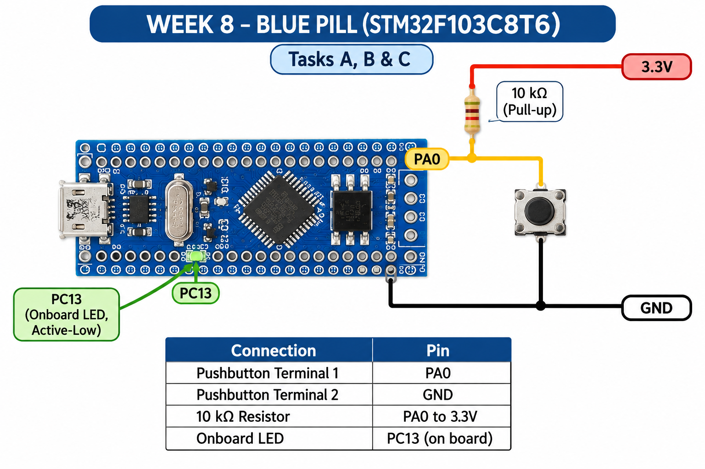

# EXPERIMENT DETAILS

**EXP:** CONTINUOUS ASSESSMENT 8

**DATE:** 21/09/2026

**NAME OF EXP:** STM32 GPIO Bring-Up and Switch-Controlled LED

**HARDWARE SETUP / PLATFORM:** CubeMX + Keil MDK + STM32 Development Board Blue Pill STM32F103C8T6

---

## TASK 8B Event-Based Control

### 1. Circuit Diagram

The experiment uses a push-button as a GPIO input and the onboard LED of the STM32 Blue Pill as a GPIO output.

- **Development Board:** STM32 Blue Pill
- **Microcontroller IC:** STM32F103C8T6
- **Input Pin:** PA0
- **Output Pin:** PC13
- **Peripheral:** Push-button and onboard LED

### 2. Core Logic / Pseudocode / Code Base

**Working Principle:**

The experiment modifies the GPIO control program to toggle the onboard LED once for each valid push-button press. A 50 ms delay is used to debounce the switch, and the input is checked again to confirm the press. The program waits until the button is released before detecting another press.

**Pseudocode:**

1. Initialize the HAL library.
2. Configure the system clock and GPIO.
3. Continuously monitor the push-button connected to PA0.
4. When PA0 becomes LOW, wait for 50 ms.
5. Read PA0 again to confirm the button press.
6. If the button is still LOW, toggle the LED on PC13.
7. Wait until the button is released.
8. Repeat the process.

**Code Base:**

The push-button state is read using `HAL_GPIO_ReadPin()`. `HAL_Delay()` provides the 50 ms debounce interval, and `HAL_GPIO_TogglePin()` changes the LED state. A release check prevents repeated toggling while the button remains pressed.

### 3. Inference

Each valid push-button press toggles the onboard LED once. The debounce delay and release check reduce false or repeated triggering caused by switch bounce.

