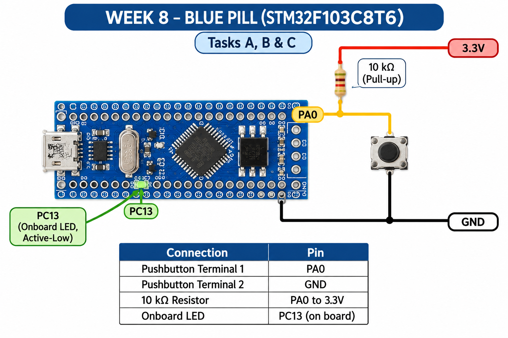

# EXPERIMENT DETAILS

**EXP:** CONTINUOUS ASSESSMENT 8

**DATE:** 21/09/2026

**NAME OF EXP:** STM32 GPIO Bring-Up and Switch-Controlled LED

**HARDWARE SETUP / PLATFORM:** CubeMX + Keil MDK + STM32 Development Board Blue Pill STM32F103C8T6

---

## TASK 8C Short Press vs Long Press

### 1. Circuit Diagram

The experiment uses a push-button as a GPIO input and the onboard LED of the STM32 Blue Pill as a GPIO output.

- **Development Board:** STM32 Blue Pill
- **Microcontroller IC:** STM32F103C8T6
- **Input Pin:** PA0
- **Output Pin:** PC13
- **Peripheral:** Push-button and onboard LED

### 2. Core Logic / Pseudocode / Code Base

**Working Principle:**

The experiment classifies a push-button press based on its duration. A press shorter than 1 second toggles the LED when blinking mode is inactive, or stops blinking when it is active. A press of 1 second or longer toggles continuous blinking mode. The LED toggles every 500 ms while blinking mode is active. A 20 ms delay is used to debounce the button.

**Pseudocode:**

1. Initialize the HAL library.
2. Configure the system clock and GPIO.
3. Continuously monitor the push-button connected to PA0.
4. When a press is detected, wait 20 ms and confirm the press.
5. Record the press start time using `HAL_GetTick()`.
6. Wait until the button is released and calculate the press duration.
7. If the press duration is 1 second or longer, toggle blinking mode.
8. Otherwise, if blinking mode is active, stop blinking.
9. Otherwise, toggle the LED once.
10. If blinking mode is active, toggle the LED every 500 ms.
11. Repeat the process.

**Code Base:**

The push-button state is read using `HAL_GPIO_ReadPin()`. `HAL_GetTick()` measures the press duration and controls the 500 ms blinking interval. `HAL_GPIO_TogglePin()` toggles the onboard LED, while `HAL_Delay()` provides the initial 20 ms debounce interval.

### 3. Inference

The system distinguishes short and long button presses. Short presses toggle the LED or stop blinking, while long presses enable or disable continuous blinking mode using STM32 HAL functions.

