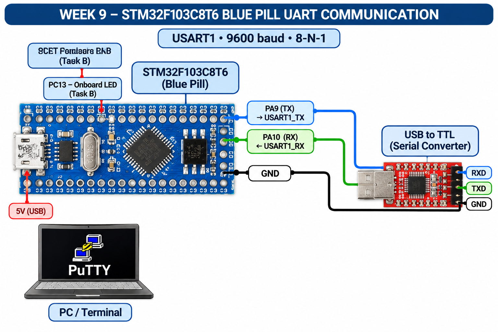

# EXPERIMENT DETAILS

**EXP:** CONTINUOUS ASSESSMENT 9

**DATE: 28/09/2026** 

**NAME OF EXP:** STM32 UART Communication and Command-Line LED Control

**HARDWARE SETUP / PLATFORM:** CubeMX + Keil MDK + STM32 Development Board Blue Pill STM32F103C8T6

---

## TASK 9A UART Data Transmission

### 1. Circuit Diagram

The experiment uses the USART1 interface of the STM32 Blue Pill to transmit a character to a serial device.

- **Development Board:** STM32 Blue Pill
- **Microcontroller IC:** STM32F103C8T6
- **UART Peripheral:** USART1
- **Baud Rate:** 9600
- **Data Transmitted:** Character `H`

### 2. Core Logic / Pseudocode / Code Base

**Working Principle:**

The experiment demonstrates UART data transmission using the STM32 HAL library. The program repeatedly transmits the character `H` through USART1 and introduces a 500 ms delay between transmissions.

**Pseudocode:**

1. Initialize the HAL library and configure the system and USART1.
2. Enter the infinite loop.
3. Store the character `H` in a data variable.
4. Transmit the character through USART1.
5. Wait for 500 ms.
6. Repeat the process continuously.

**Code Base:**

UART data is transmitted using `HAL_UART_Transmit()`. The USART1 peripheral is configured for 9600 baud, 8-bit data, no parity and 1 stop bit. `HAL_Delay()` provides the 500 ms interval between transmissions.

### 3. Inference

The STM32 Blue Pill repeatedly transmits the character `H` through USART1 at 500 ms intervals, demonstrating basic UART serial communication using STM32 HAL functions.

