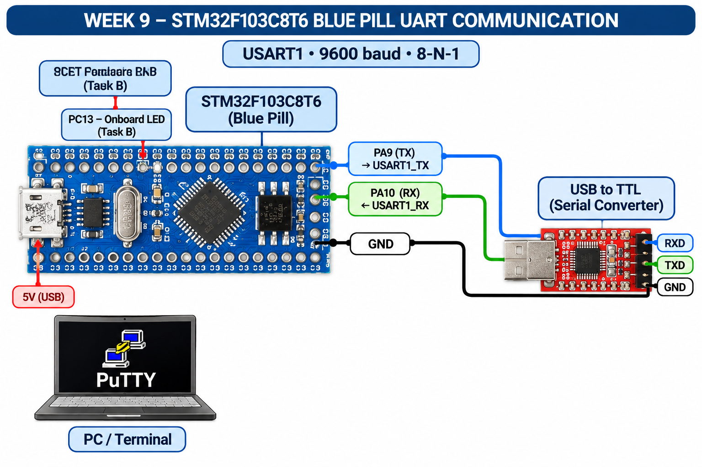

# EXPERIMENT DETAILS

**EXP:** CONTINUOUS ASSESSMENT 9

**DATE: 28/09/2026** 

**NAME OF EXP:** STM32 UART Communication and Command-Line LED Control

**HARDWARE SETUP / PLATFORM:** CubeMX + Keil MDK + STM32 Development Board Blue Pill STM32F103C8T6

---

## TASK 9B UART Command Line Interface

### 1. Circuit Diagram

The experiment uses USART1 for serial communication with a PC terminal and controls the onboard LED of the STM32 Blue Pill through GPIO.

- **Development Board:** STM32 Blue Pill
- **Microcontroller IC:** STM32F103C8T6
- **UART Peripheral:** USART1
- **Baud Rate:** 9600
- **Output Pin:** PC13
- **Peripheral:** PC terminal and onboard LED

### 2. Core Logic / Pseudocode / Code Base

**Working Principle:**

The experiment implements a UART-based command-line interface. The STM32 receives characters from the PC terminal through USART1, echoes each received character and processes the command when a carriage return or newline is received. The commands `ON`, `OFF` and `TOGGLE` control the onboard LED connected to PC13. The LED is active-low.

**Pseudocode:**

1. Initialize the HAL library.
2. Configure the system clock, GPIO and USART1.
3. Display the UART CLI ready message on the terminal.
4. Continuously receive one character through USART1.
5. Echo the received character to the terminal.
6. If a carriage return or newline is received, terminate the command string.
7. If the command is `ON`, set PC13 LOW to turn the LED ON.
8. If the command is `OFF`, set PC13 HIGH to turn the LED OFF.
9. If the command is `TOGGLE`, toggle the LED state.
10. For any other command, display an unknown-command message.
11. Clear the receive buffer and continue waiting for the next command.

**Code Base:**

The UART character is received using `HAL_UART_Receive()` and echoed using `HAL_UART_Transmit()`. `strcmp`-style case-insensitive comparison is performed using `strcasecmp()` to identify the commands. The onboard LED is controlled using `HAL_GPIO_WritePin()` and `HAL_GPIO_TogglePin()` on GPIO pin PC13. `memset()` clears the receive buffer after each command.

### 3. Inference

The STM32 Blue Pill receives and processes serial commands from the PC terminal to turn the onboard LED ON, turn it OFF or toggle its state. This demonstrates UART communication, command parsing and GPIO control using STM32 HAL functions.

